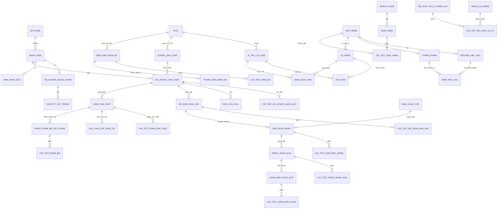

# TÀI LIỆU THIẾT KẾ CƠ SỞ DỮ LIỆU MARVEL WMS

Tài liệu này mô tả chi tiết Cơ sở dữ liệu hợp nhất `marvel_wms` cho toàn bộ 6 phân hệ của Hệ thống Quản lý kho nhà máy Bánh kẹo Marvel Sweet, dựa trên thiết kế miền `docs/domain_model.svg`, `docs/class_diagram.jpg`, các quy tắc nghiệp vụ BR-01..BR-10 và dữ liệu kế thừa từ các thành viên.

---

## 1. Sơ đồ Thực thể - Mối quan hệ (ERD Mermaid)

---

## 2. Bảng Ánh xạ Danh pháp ("Tên cũ trong code thành viên $\rightarrow$ Tên mới chuẩn hóa")

Nhằm bảo toàn tính đúng đắn của logic nghiệp vụ cũ đồng thời tuân thủ 100% quy ước mã nguồn tại `AGENT_RULES.md` (tên bảng `snake_case`, tên cột `camelCase`, trạng thái `IN_HOA_KHONG_DAU`):

| Phân hệ nguồn | Tên cũ / Cột cũ trong code thành viên | Tên mới chuẩn hóa trong `marvel_wms` | Ý nghĩa nghiệp vụ & Quy ước |
| :--- | :--- | :--- | :--- |
| **Kế hoạch LKH** (`warehouse_lkh.sql`) | `mat_hang.maHang` | `mat_hang.maSKU` | Mã định danh chuẩn toàn hệ thống (`SP001`, `NVL001`...) |
| | `chi_tiet_de_nghi_mua.maNVL` | `chi_tiet_de_nghi_mua_nvl.maSKU` | Khóa ngoại trỏ về `mat_hang(maSKU)` |
| | `ke_hoach_san_xuat.maNV` | `ke_hoach_san_xuat.maNhanVienLap` | Nhân viên lập kế hoạch (`nhan_vien.maNhanVien`) |
| | `chi_tiet_ke_hoach_sx` | `chi_tiet_ke_hoach_san_xuat` | Bảng dòng hàng kế hoạch |
| | `nhan_vien.maNV` | `nhan_vien.maNhanVien` | Mã chuẩn `NV000` đến `NV005` |
| | `ton_kho_lo` | `ton_kho` | Bảng tồn kho thực tế theo lô và vị trí |
| **Điều phối nhập** (`mock_banh_keo.json`) | `YeuCauNhapKho.MaYeuCau` (`YCN26100001`..) | `phieu_nhap_kho.maPhieuNhap` | Thống nhất `YeuCauNhapKho` vào thực thể `phieu_nhap_kho` |
| | `ChiTietYeuCauNhap.SoLuong` | `chi_tiet_phieu_nhap_kho.soLuong` | Số lượng hàng nhập |
| | `LenhDieuPhoiKho.MaNhanVien` | `lenh_dieu_phoi_kho.maNhanVienThucHien` | Phân công nhân viên kho thực hiện cất hàng |
| | `Kho.SucChuaDaHenNhap` | `kho.sucChuaDaHenNhap` | Dung lượng đã đặt chỗ khi tiếp nhận phiếu nhập |
| **Kiểm kê** (`kiem_ke_banh_keo.sql`) | `mat_hang.ma_sku` (`BK-QB-001`..) | `mat_hang.maSKU` | Chuẩn camelCase theo domain model |
| | `bien_ban_kiem_ke.ma_bien_ban` | `bien_ban_kiem_ke.maBienBan` | Mã biên bản `BBKK-2026-001` đến `005` |
| | `bien_ban_kiem_ke.nguoi_lap` | `bien_ban_kiem_ke.maNhanVienLap` | Liên kết khóa ngoại với bảng `nhan_vien` |
| | `chi_tiet_kiem_ke.so_luong_so_sach` | `chi_tiet_kiem_ke.soLuongSoSach` | Số lượng sổ sách |
| | `chi_tiet_kiem_ke.so_luong_thuc_te` | `chi_tiet_kiem_ke.soLuongThucTe` | Số lượng kiểm đếm thực tế |
| | `chi_tiet_kiem_ke.gia_tri_chenh_lech` | `chi_tiet_kiem_ke.giaTriChenhLech` | Chênh lệch giá trị |
| **Hàng lỗi hỏng** (`banh_keo.sql`) | `hang_loi_hong.ma_hang_loi` (`HL001`..) | `hang_loi_hong.maHangLoi` | Mã dòng hàng lỗi |
| | `hang_loi_hong.so_luong_loi_hong` | `hang_loi_hong.soLuongLoiHong` | Tổng số lượng lỗi ban đầu |
| | `de_xuat_xu_ly.ma_de_xuat` | `de_xuat_xu_ly_hang_loi.maDeXuat` | Mã đề xuất `DXLH-YYYYMMDD-NNNN` |
| | `de_xuat_xu_ly.phuong_an` | `de_xuat_xu_ly_hang_loi.phuongAn` | `TIEU_HUY` hoặc `TRA_NCC` |
| | `chi_tiet_de_xuat.so_lo`, `han_su_dung` | `chi_tiet_de_xuat_xu_ly.soLo`, `ngayHetHan` | Snapshot thông tin lô tại thời điểm lập đề xuất |
| **Phân bổ sản xuất** (`PhanBoModel.php`) | Áo sơ mi nam, Vải Cotton | `SP001`, `NVL001`, `NVL002`, `NVL004` | Chuyển đổi toàn bộ từ may mặc sang bánh kẹo |

---

## 3. Danh sách Điều chỉnh & Mở rộng so với Domain Model ban đầu

| Thực thể / Cột | Hiện trạng trong `domain_model.svg` | Thay đổi trong `schema.sql` | Lý do kỹ thuật & Nghiệp vụ bắt buộc |
| :--- | :--- | :--- | :--- |
| **`ton_kho`** | Chỉ có `LO_HANG` và `VI_TRI_LUU_KHO` độc lập | Bổ sung bảng liên kết `ton_kho` (`maLo`, `maViTri`, `soLuongThucTe`, `soLuongGiuCho`, `UNIQUE(maLo, maViTri)`) | Một lô hàng có thể phân tán trên nhiều vị trí; một vị trí có thể chứa nhiều lô. Cần bảng chi tiết để quản lý tồn thực tế và số lượng giữ chỗ cấp vị trí. |
| **`nvl_can_cap_lenh_sx`** | Chưa có trong domain model tĩnh | Thêm bảng `nvl_can_cap_lenh_sx` (`maLenhSX`, `maSKU`, `soLuongCanCap`, `soLuongDaPhanBo`) | **Thực thi bắt buộc BR-06**: Lệnh sản xuất khi phát hành phải giữ chỗ NVL (trừ tồn khả dụng nhưng vẫn nằm trong tồn thực tế). Bảng này lưu vết lượng giữ chỗ cho đến khi phiếu phân bổ hoàn tất. |
| **`de_xuat_xu_ly_hang_loi`** | Trong diagram vẽ chung là `PHUONG_AN_XU_LY` | Tách rõ bảng chứng từ `de_xuat_xu_ly_hang_loi` và `chi_tiet_de_xuat_xu_ly` | Đáp ứng nghiệp vụ lập đề xuất xử lý hàng lỗi của QLK và trình BGD phê duyệt theo use case chi tiết. |
| **`xuong_san_xuat.maKhoNVL`** | Quan hệ gián tiếp | Thêm trực tiếp cột `maKhoNVL` khóa ngoại trỏ tới `kho(maKho)` | Xác định kho phụ trách cung ứng NVL cho xưởng theo yêu cầu tại mục 2 tài liệu hướng dẫn. |
| **Chuẩn hóa ENUM** | Một số dùng tiếng Việt hoặc lẫn lộn chữ thường | Toàn bộ chuyển sang `IN_HOA_KHONG_DAU` (`HOAT_DONG`, `CHO_DUYET`, `DA_DUYET`, `CHO_KIEM`, `DAT`, `KHONG_DAT`, `CACH_LY`...) | Tránh lỗi so sánh chuỗi phân biệt hoa thường và đồng bộ hóa trên mọi hệ điều hành (Windows/Linux). |

---

## 4. Công thức và Logic của 3 Database Views

### 4.1. View `vw_ton_kho_lo`
- **Mục đích**: Tính toán tồn kho khả dụng của từng lô hàng tại từng vị trí lưu kho.
- **Công thức**: `tonKhaDungLo = soLuongThucTe - soLuongGiuCho`.
- **Ràng buộc**:
  - `trangThaiChatLuong = 'DAT'` (loại bỏ `CHO_KIEM`, `KHONG_DAT`, `CACH_LY` theo BR-03, BR-09).
  - `ngayHetHan >= CURDATE()` (loại bỏ các lô đã hết hạn sử dụng).
  - `tonKhaDungLo > 0`.

### 4.2. View `vw_ton_kho_kha_dung`
- **Mục đích**: Xác định tổng tồn kho khả dụng của từng mã mặt hàng (`maSKU`) sẵn sàng để cấp phát hoặc sản xuất.
- **Công thức (BR-06)**:
  $$\text{tonKhaDung} = \sum(\text{tonKhaDungLo của } vw\_ton\_kho\_lo) - \sum(\text{soLuongCanCap} - \text{soLuongDaPhanBo của các LSX } DA\_PHAT / DANG\_PHAN\_BO)$$

### 4.3. View `vw_hang_dang_ve`
- **Mục đích**: Tính tổng lượng hàng nguyên vật liệu đã đặt mua nhưng chưa nhập kho.
- **Công thức**:
  $$\text{hangDangVe} = \sum(\text{soLuongDat} - \text{soLuongDaNhan}) \quad \text{với các đơn mua hàng ở trạng thái } CHO\_DUYET, DA\_DUYET, DANG\_GIAO$$

